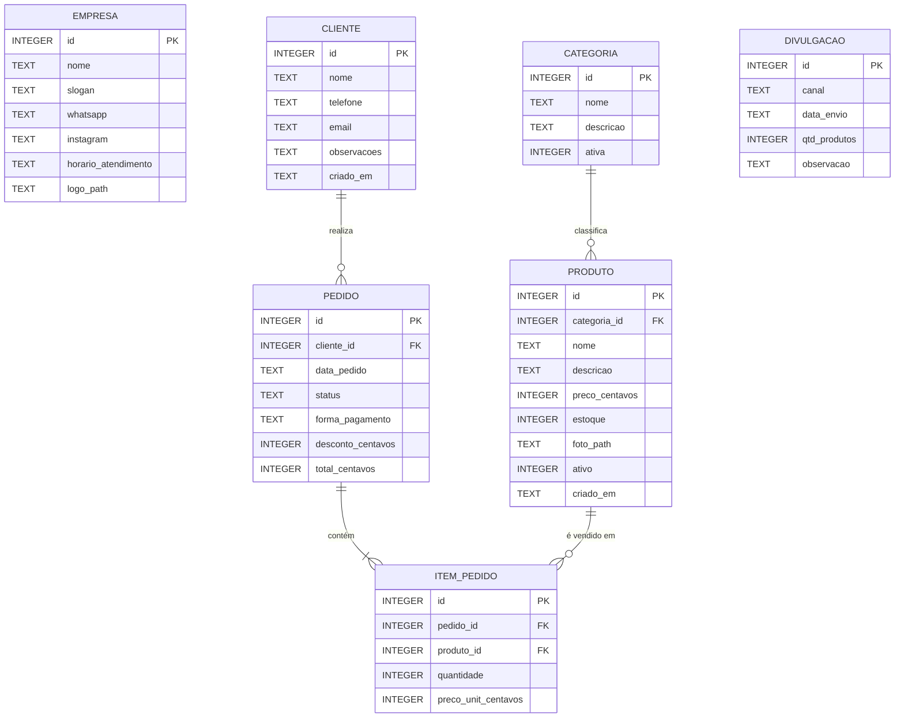

# 5. Modelo ER do banco de dados local

Banco: **SQLite**, arquivo `vitrine.db` armazenado no aparelho.
Total: **7 tabelas**, cada uma com mais de 3 colunas, com relacionamentos entre elas.

## Diagrama entidade-relacionamento



> `EMPRESA` guarda uma única linha de configuração (`id = 1`). `DIVULGACAO` não possui chave estrangeira: registra cada compartilhamento do catálogo e é cruzada por **data** com `PEDIDO` nas análises.

## Dicionário de dados

### Tabela `empresa`
| Coluna | Tipo | Restrições | Descrição |
|---|---|---|---|
| id | INTEGER | PK, `CHECK (id = 1)` | Linha única de configuração |
| nome | TEXT | NOT NULL | Nome do negócio |
| slogan | TEXT | — | Frase de apresentação |
| whatsapp | TEXT | — | Telefone para contato |
| instagram | TEXT | — | Perfil no Instagram |
| horario_atendimento | TEXT | — | Texto livre |
| logo_path | TEXT | — | Caminho local da imagem do logotipo |

### Tabela `categoria`
| Coluna | Tipo | Restrições | Descrição |
|---|---|---|---|
| id | INTEGER | PK, AUTOINCREMENT | Identificador |
| nome | TEXT | NOT NULL, UNIQUE | Nome da categoria |
| descricao | TEXT | — | Descrição opcional |
| ativa | INTEGER | NOT NULL, DEFAULT 1, `CHECK (ativa IN (0,1))` | 1 = ativa |

### Tabela `produto`
| Coluna | Tipo | Restrições | Descrição |
|---|---|---|---|
| id | INTEGER | PK, AUTOINCREMENT | Identificador |
| categoria_id | INTEGER | FK → categoria.id, `ON DELETE SET NULL` | Categoria do produto |
| nome | TEXT | NOT NULL | Nome do produto |
| descricao | TEXT | — | Descrição |
| preco_centavos | INTEGER | NOT NULL, `CHECK (preco_centavos >= 0)` | Preço em centavos |
| estoque | INTEGER | NOT NULL, DEFAULT 0, `CHECK (estoque >= 0)` | Quantidade disponível |
| foto_path | TEXT | — | Caminho local da foto |
| ativo | INTEGER | NOT NULL, DEFAULT 1, `CHECK (ativo IN (0,1))` | Visível no catálogo |
| criado_em | TEXT | NOT NULL | Data/hora ISO 8601 |

### Tabela `cliente`
| Coluna | Tipo | Restrições | Descrição |
|---|---|---|---|
| id | INTEGER | PK, AUTOINCREMENT | Identificador |
| nome | TEXT | NOT NULL | Nome do cliente |
| telefone | TEXT | UNIQUE | Telefone (evita duplicidade) |
| email | TEXT | — | E-mail opcional |
| observacoes | TEXT | — | Anotações livres |
| criado_em | TEXT | NOT NULL | Data/hora ISO 8601 |

### Tabela `pedido`
| Coluna | Tipo | Restrições | Descrição |
|---|---|---|---|
| id | INTEGER | PK, AUTOINCREMENT | Número do pedido |
| cliente_id | INTEGER | FK → cliente.id, `ON DELETE SET NULL` | Cliente (pode ser venda sem cadastro) |
| data_pedido | TEXT | NOT NULL | Data/hora ISO 8601 |
| status | TEXT | NOT NULL, `CHECK (status IN ('ABERTO','PAGO','CANCELADO'))` | Situação |
| forma_pagamento | TEXT | `CHECK (forma_pagamento IN ('PIX','DINHEIRO','CARTAO','OUTRO'))` | Forma de pagamento |
| desconto_centavos | INTEGER | NOT NULL, DEFAULT 0, `CHECK (desconto_centavos >= 0)` | Desconto em centavos |
| total_centavos | INTEGER | NOT NULL, `CHECK (total_centavos >= 0)` | Total final em centavos |

### Tabela `item_pedido`
| Coluna | Tipo | Restrições | Descrição |
|---|---|---|---|
| id | INTEGER | PK, AUTOINCREMENT | Identificador |
| pedido_id | INTEGER | NOT NULL, FK → pedido.id, `ON DELETE CASCADE` | Pedido ao qual pertence |
| produto_id | INTEGER | NOT NULL, FK → produto.id, `ON DELETE RESTRICT` | Produto vendido |
| quantidade | INTEGER | NOT NULL, `CHECK (quantidade > 0)` | Quantidade |
| preco_unit_centavos | INTEGER | NOT NULL, `CHECK (preco_unit_centavos >= 0)` | Preço no momento da venda |

Restrição adicional: `UNIQUE (pedido_id, produto_id)` — um produto aparece uma vez por pedido (a quantidade é ajustada).

### Tabela `divulgacao`
| Coluna | Tipo | Restrições | Descrição |
|---|---|---|---|
| id | INTEGER | PK, AUTOINCREMENT | Identificador |
| canal | TEXT | NOT NULL, `CHECK (canal IN ('WHATSAPP','INSTAGRAM','OUTRO'))` | Canal usado |
| data_envio | TEXT | NOT NULL | Data/hora ISO 8601 |
| qtd_produtos | INTEGER | NOT NULL, `CHECK (qtd_produtos >= 0)` | Quantidade de produtos no catálogo enviado |
| observacao | TEXT | — | Anotação opcional |

## Relacionamentos

| Relacionamento | Cardinalidade | Chave estrangeira | Regra de exclusão |
|---|---|---|---|
| categoria → produto | 1 : N | `produto.categoria_id` | `SET NULL` (produto fica sem categoria) |
| cliente → pedido | 1 : N | `pedido.cliente_id` | `SET NULL` (preserva o histórico de vendas) |
| pedido → item_pedido | 1 : N (mínimo 1 item) | `item_pedido.pedido_id` | `CASCADE` (excluir pedido remove os itens) |
| produto → item_pedido | 1 : N | `item_pedido.produto_id` | `RESTRICT` (impede excluir produto já vendido; usa-se desativação) |

`pedido` e `produto` possuem relação **N:N**, resolvida pela tabela associativa `item_pedido`.

## Script de criação (DDL)

```sql
PRAGMA foreign_keys = ON;

CREATE TABLE empresa (
  id                  INTEGER PRIMARY KEY CHECK (id = 1),
  nome                TEXT NOT NULL,
  slogan              TEXT,
  whatsapp            TEXT,
  instagram           TEXT,
  horario_atendimento TEXT,
  logo_path           TEXT
);

CREATE TABLE categoria (
  id        INTEGER PRIMARY KEY AUTOINCREMENT,
  nome      TEXT NOT NULL UNIQUE,
  descricao TEXT,
  ativa     INTEGER NOT NULL DEFAULT 1 CHECK (ativa IN (0,1))
);

CREATE TABLE produto (
  id             INTEGER PRIMARY KEY AUTOINCREMENT,
  categoria_id   INTEGER REFERENCES categoria(id) ON DELETE SET NULL,
  nome           TEXT NOT NULL,
  descricao      TEXT,
  preco_centavos INTEGER NOT NULL CHECK (preco_centavos >= 0),
  estoque        INTEGER NOT NULL DEFAULT 0 CHECK (estoque >= 0),
  foto_path      TEXT,
  ativo          INTEGER NOT NULL DEFAULT 1 CHECK (ativo IN (0,1)),
  criado_em      TEXT NOT NULL
);

CREATE TABLE cliente (
  id          INTEGER PRIMARY KEY AUTOINCREMENT,
  nome        TEXT NOT NULL,
  telefone    TEXT UNIQUE,
  email       TEXT,
  observacoes TEXT,
  criado_em   TEXT NOT NULL
);

CREATE TABLE pedido (
  id                INTEGER PRIMARY KEY AUTOINCREMENT,
  cliente_id        INTEGER REFERENCES cliente(id) ON DELETE SET NULL,
  data_pedido       TEXT NOT NULL,
  status            TEXT NOT NULL CHECK (status IN ('ABERTO','PAGO','CANCELADO')),
  forma_pagamento   TEXT CHECK (forma_pagamento IN ('PIX','DINHEIRO','CARTAO','OUTRO')),
  desconto_centavos INTEGER NOT NULL DEFAULT 0 CHECK (desconto_centavos >= 0),
  total_centavos    INTEGER NOT NULL CHECK (total_centavos >= 0)
);

CREATE TABLE item_pedido (
  id                  INTEGER PRIMARY KEY AUTOINCREMENT,
  pedido_id           INTEGER NOT NULL REFERENCES pedido(id)  ON DELETE CASCADE,
  produto_id          INTEGER NOT NULL REFERENCES produto(id) ON DELETE RESTRICT,
  quantidade          INTEGER NOT NULL CHECK (quantidade > 0),
  preco_unit_centavos INTEGER NOT NULL CHECK (preco_unit_centavos >= 0),
  UNIQUE (pedido_id, produto_id)
);

CREATE TABLE divulgacao (
  id           INTEGER PRIMARY KEY AUTOINCREMENT,
  canal        TEXT NOT NULL CHECK (canal IN ('WHATSAPP','INSTAGRAM','OUTRO')),
  data_envio   TEXT NOT NULL,
  qtd_produtos INTEGER NOT NULL CHECK (qtd_produtos >= 0),
  observacao   TEXT
);

-- Índices para acelerar os relatórios
CREATE INDEX idx_produto_categoria ON produto(categoria_id);
CREATE INDEX idx_pedido_data       ON pedido(data_pedido);
CREATE INDEX idx_pedido_cliente    ON pedido(cliente_id);
CREATE INDEX idx_item_produto      ON item_pedido(produto_id);
```

## Convenções

- **Datas e horas:** texto em ISO 8601 (`2026-10-20T12:30:00`), formato que o SQLite compara e processa com as funções `date()` e `strftime()`.
- **Dinheiro:** inteiros em centavos (R$ 12,50 → `1250`).
- **Booleanos:** `INTEGER` com valores 0 ou 1, pois o SQLite não possui tipo booleano.
- **Chaves estrangeiras:** ativadas com `PRAGMA foreign_keys = ON` a cada abertura do banco.
