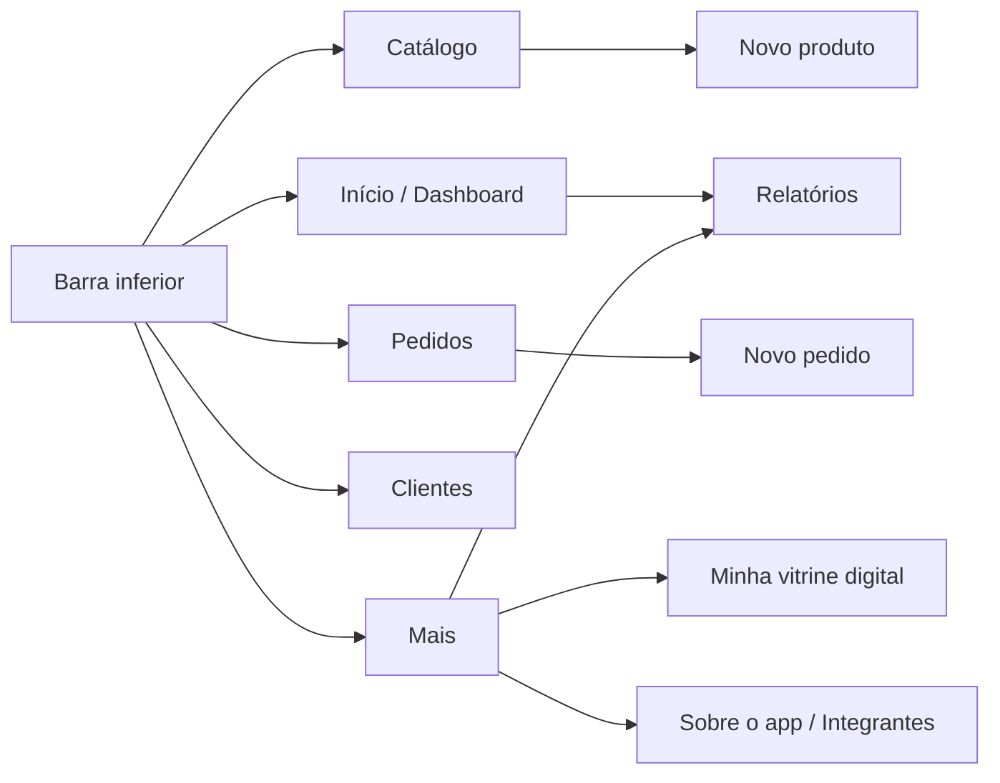
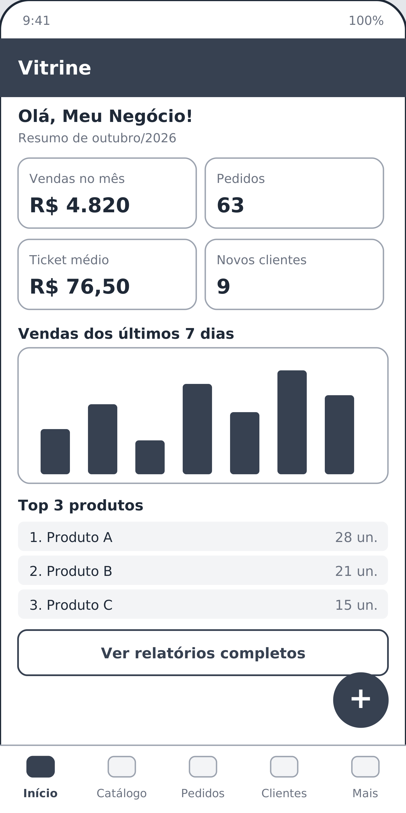
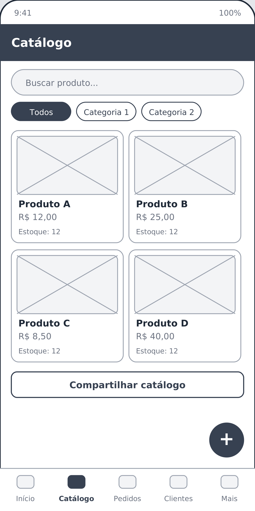
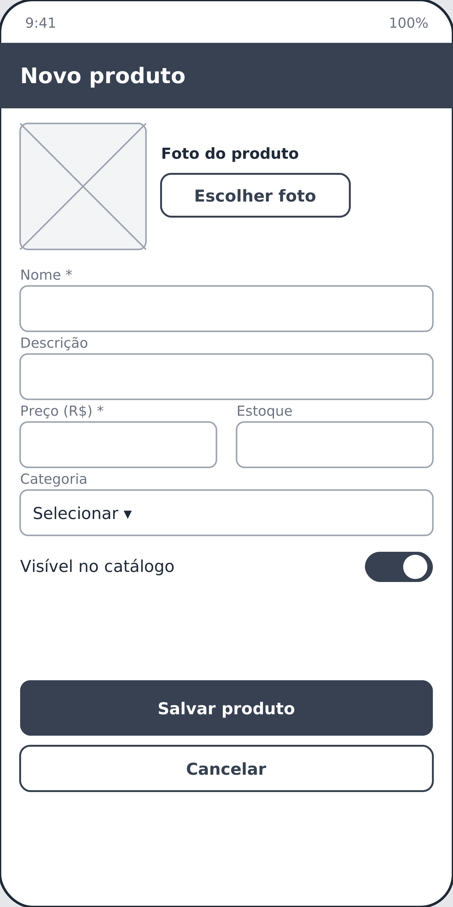
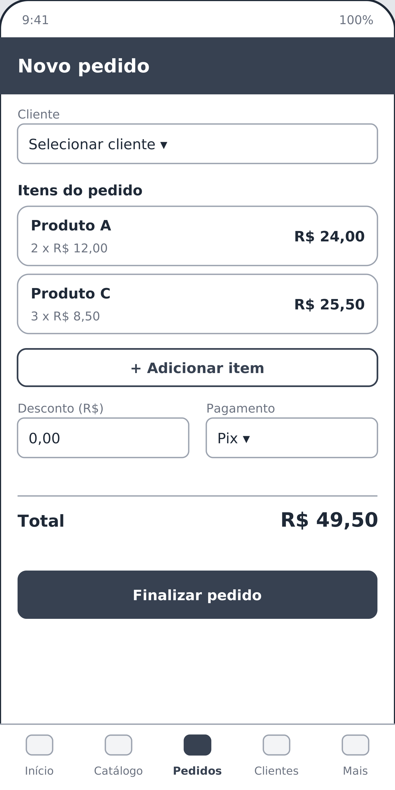
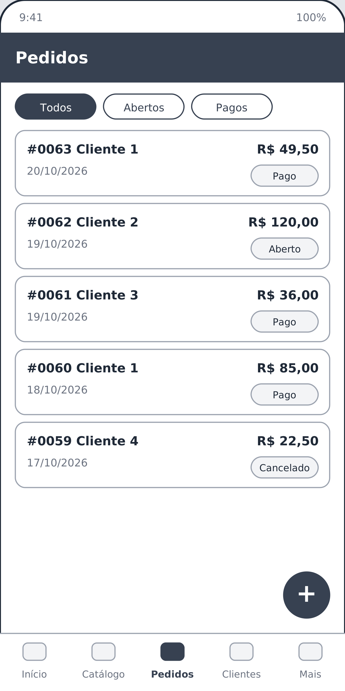
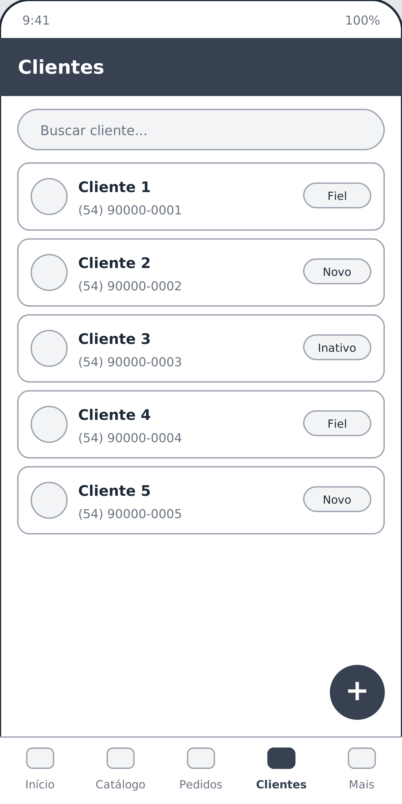
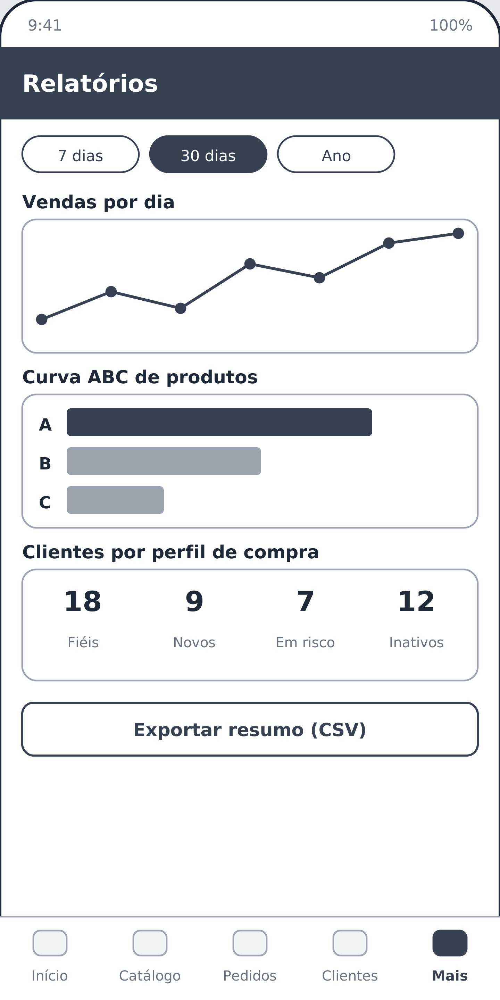
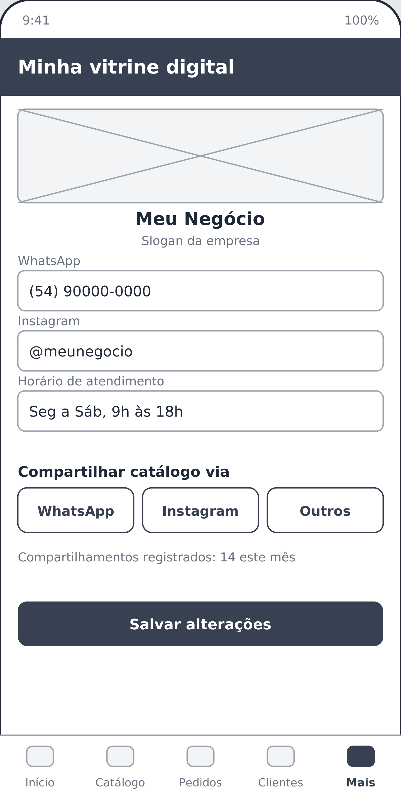
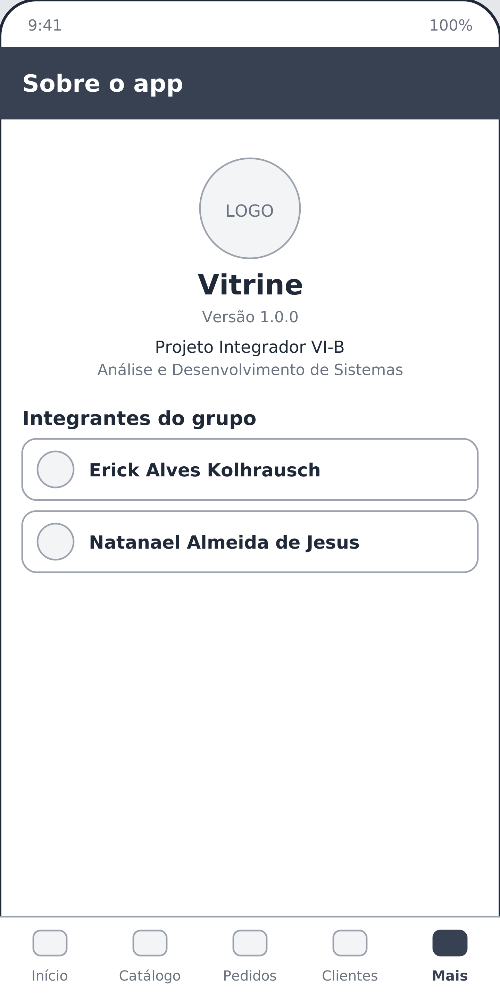

# 6 e 7. Wireframes em alta definição

Os wireframes foram desenhados para tela de smartphone (proporção 1:2) e exportados em **1440 × 2880 pixels** (PNG), com os arquivos vetoriais **SVG** correspondentes na pasta [`wireframes/`](../wireframes/).

## Mapa de navegação

## Tela 1 — Dashboard
Resumo do mês (vendas, pedidos, ticket médio, novos clientes), gráfico dos últimos 7 dias e top 3 produtos.

## Tela 2 — Catálogo
Lista em grade dos produtos com busca, filtro por categoria e botão para compartilhar o catálogo.

## Tela 3 — Novo produto
Formulário de cadastro com foto, nome, descrição, preço, estoque, categoria e visibilidade no catálogo.

## Tela 4 — Novo pedido
Seleção de cliente, inclusão de itens, desconto, forma de pagamento e total calculado.

## Tela 5 — Pedidos
Histórico de pedidos com filtro por status.

## Tela 6 — Clientes
Lista de clientes com busca e etiqueta de perfil (fiel, novo, inativo).

## Tela 7 — Relatórios
Gráfico de vendas por dia, curva ABC, perfil de clientes e exportação em CSV.

## Tela 8 — Minha vitrine digital
Dados públicos do negócio (contatos e horário) e atalhos de compartilhamento do catálogo.

## Tela 9 — Sobre o app (Integrantes)
Tela exigida pelo item 7 da entrega: exibe o **nome completo de todos os integrantes do grupo**, além do nome do app, versão e curso.

> Os nomes mostrados no wireframe são marcadores de posição e serão substituídos pelos nomes completos reais na implementação.
